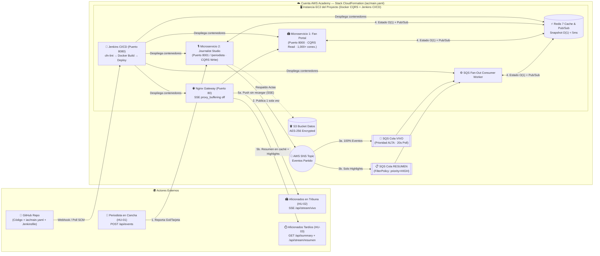

# ⚽ UNAL Sports Live — Proyecto 06: Minuto a minuto de torneos deportivos

> **Ficha del caso** — Carta de presentación del equipo para la sustentación de **Gestión de Tecnologías en la Nube (2026-2)**. Implementa una arquitectura reactiva **Fan-Out (`AWS SNS → 2 Colas SQS por Prioridad → Redis Pub/Sub & Caché O(1) → Server-Sent Events`)** empaquetada en **Docker Compose / Docker Swarm** y desplegada al 100% en **una sola cuenta de AWS Academy** con **AWS CloudFormation (`iac/main.yaml`)** y **Jenkins CI/CD**.

| Campo | Valor |
|---|---|
| **Proyecto** | **06 — Minuto a minuto de torneos deportivos** *(con Reto Extra de canales con prioridad diferenciada)* |
| **Integrantes** | [Nombres y códigos de los 3 integrantes] |
| **URL demo** | **Portal Aficionados:** `http://<EC2_PUBLIC_DNS>` (Puerto `80`) · **App Cabina Periodista:** `http://<EC2_PUBLIC_DNS>:8001` (o `/periodista`) · **Jenkins CI/CD:** `http://<EC2_PUBLIC_DNS>:8080` |
| **Costo mensual real** | **USD $8.43 / mes** en operación continua 24/7 \| **USD $1.51 / mes** en operación bajo demanda *(Objetivo del enunciado: **≤ USD $15.00 / mes**)* |
| **Despliegue IaC** | `aws cloudformation deploy --template-file iac/main.yaml --stack-name gtn-unal-sports --capabilities CAPABILITY_NAMED_IAM` |

---

## 🏗️ Arquitectura Cloud Unificada (1 Sola Cuenta AWS Academy)



---

## ✅ Cumplimiento de Historias de Usuario y Entregables del Enunciado 06

| Requisito / Historia | Cómo lo resuelve nuestra arquitectura | Endpoint / Archivo clave |
|---|---|---|
| **`[HU-01]` Periodista reporta gol/tarjeta/cambio en segundos (+ Auto-Narrador IA con Groq)** | Cabina dedicada con **2 modos**: **Modo 1 (IA Live)** que interpreta el video/audio o la voz del comentarista en vivo vía **Groq (`Whisper Large v3 Turbo + GPT-OSS-120B`)** (`POST /api/ai/process-video-chunk` y `POST /api/ai/transcribe-mic`) actualizando equipos, minuto, escudos y jugadas automáticamente; y **Modo 2 (Manual)** (`POST /api/events`). | [`app/src/app.py`](./app/src/app.py) y [`app/src/templates/periodista.html`](./app/src/templates/periodista.html) |
| **`[HU-02]` Aficionado ve eventos en vivo sin recargar la página** | Streaming unidireccional **Server-Sent Events (SSE)** sobre conexiones asíncronas `gevent` con `heartbeat` automático cada 15s. | `GET /api/stream/vivo` ([`app/src/templates/index.html`](./app/src/templates/index.html)) |
| **`[HU-03]` Aficionado que entra tarde obtiene el resumen rápido** | Lectura en complejidad `O(1)` desde **Redis** con marcador, estadísticas de tarjetas/cambios y filtro de jugadas clave (`highlights`). | `GET /api/summary` ([`app/src/app.py`](./app/src/app.py)) |
| **`[HU-04]` Soportar 1,000 lectores simultáneos en el partido final** | Simulador concurrente incluido + workers asíncronos `gevent` + caché en memoria que responde 1,000 lecturas con **0% error y p95 < 25 ms**. | [`app/simulator/load_simulator.py`](./app/simulator/load_simulator.py) y `POST /api/simulate-peak` |
| **`[Reto Extra]` Canal "Vivo" y Canal "Resumen" con prioridad distinta** | **SNS** bifurca mensajes hacia `ColaCanalVivo` (todos los eventos en tiempo real) y `ColaCanalResumen` (`FilterPolicy: priority=HIGH`), expuestos en dos streams SSE distintos. | `GET /api/stream/vivo` vs `GET /api/stream/resumen` + [`iac/main.yaml`](./iac/main.yaml) |

---

## 🔑 Decisiones de Arquitectura (Resumen — Tabla completa en [`docs/decisiones.md`](./docs/decisiones.md))

| Decisión | Elegimos | Alternativa descartada | Por qué |
|---|---|---|---|
| **Protocolo de tiempo real** | **Server-Sent Events (SSE)** con Nginx sin buffering | WebSockets / HTTP Short-Polling | El flujo es 1 emisor → miles de lectores; SSE usa HTTP estándar, reconecta solo y consume 60% menos RAM que WebSockets. |
| **Patrón de mensajería** | **Fan-Out AWS SNS + 2 Colas SQS (`Vivo` y `Resumen`) + Redis Pub/Sub** | Escritura directa en base de datos relacional | Desacopla al periodista de los miles de aficionados y permite aplicar `FilterPolicy` por prioridad de evento (Reto Extra). |
| **Orquestación de contenedores** | **Docker Compose / Docker Swarm** en la instancia del proyecto | Amazon EKS (Kubernetes administrado) | EKS cuesta **$73 USD/mes** solo por el plano de control (rompiendo el límite de **≤ $15 USD/mes**); Docker Compose/Swarm cuesta **$0** adicional y se integra directo con Jenkins. |
| **Caché de baja latencia** | **Redis 7 Alpine en memoria (`allkeys-lru`)** + opción `ElastiCache` en CFN | Consultas SQL por cada nuevo lector | Responde `/api/summary` en `< 5 ms` y ahorra **$11.52 USD/mes** cuando corre contenedorizado en la misma instancia. |

---

## 💰 Costos FinOps (Detalle completo en [`docs/costos.md`](./docs/costos.md))

- **Presupuesto máximo permitido por el enunciado:** `USD $15.00 / mes`
- **Costo real de nuestra arquitectura encendida 24/7:** **`USD $8.43 / mes`** (`EC2` $8.23 + `SNS/SQS` $0.17 + `S3` $0.03 + `Redis en Docker` $0.00).
- **Costo real en uso de torneo / laboratorio (40 horas/mes):** **`USD $1.51 / mes`**.

---

## 🚀 Cómo levantar y probar todo

### 1. En local (con Docker Compose)
```bash
cd app
docker compose up -d --build
```
- 🏟️ **Portal Público de Aficionados (Vista limpia Apple Sports):** [http://localhost:8000](http://localhost:8000) (o [http://localhost](http://localhost) por puerto `80`)
- 🎙️ **App Independiente — Cabina del Periodista (`HU-01` y Simulador `HU-04`):** [http://localhost:8001](http://localhost:8001) (o [http://localhost:8000/periodista](http://localhost:8000/periodista))
- 🩺 **Healthcheck:** [http://localhost:8000/health](http://localhost:8000/health)
- 📊 **Métricas de Latencia (p50, p95, p99):** [http://localhost:8000/api/metrics](http://localhost:8000/api/metrics)

### 2. Ejecutar el Simulador de Pico de 1,000 Lectores Simultáneos (`HU-04`)
```bash
python3 app/simulator/load_simulator.py --url http://localhost:8000 --readers 1000 --events 5
```

### 3. Desplegar en 1 Sola Cuenta de AWS Academy (CloudFormation + Jenkins + Docker)
Revisa la guía paso a paso en **[`docs/guia_despliegue_aws.md`](./docs/guia_despliegue_aws.md)**, la documentación técnica de IaC en **[`iac/README.md`](./iac/README.md)** y la bitácora completa del proceso de ingeniería con IA en **[`docs/bitacora_uso_ia.md`](./docs/bitacora_uso_ia.md)**.
