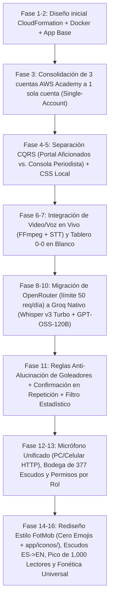

# Bitácora de Uso de Inteligencia Artificial — Proyecto 06: Minuto a Minuto de Torneos Deportivos

**Curso:** Gestión de Tecnologías en la Nube (`GTN-2026-2`)  
**Caso Asignado:** Proyecto 06 — *Minuto a minuto de torneos deportivos*  
**Repositorio / Carpeta de Solución:** `solucion_proyecto/`  
**Metodología de Trabajo con IA:** Desarrollo iterativo guiado por criterio humano (*"Feedback y validación arquitectónica antes de tocar código"*).

---

## 1. Resumen Ejecutivo y Rol de la IA

En este proyecto la Inteligencia Artificial se utilizó en **dos dimensiones complementarias**:
1. **Como Asistente de Ingeniería de Software y Arquitectura Cloud (Pair Programming):** Generación de infraestructura como código (`iac/main.yaml` en CloudFormation validado con `cfn-lint`), contenedorización (`Dockerfile`, `docker-compose.yml`, `docker-stack.swarm.yml`), pipeline CI/CD (`Jenkinsfile`), documentación FinOps/Well-Architected y desarrollo full-stack de la plataforma **UNAL Sports**.
2. **Como Componente Funcional en Tiempo Real dentro de la Aplicación (`Groq API`):** Transcripción de audio deportivo en vivo mediante **`whisper-large-v3-turbo`** (con extracción FFmpeg y solapamiento de 4 segundos) e interpretación editorial estructurada con **`openai/gpt-oss-120b`** para transformar la voz real del comentarista de un video o micrófono en eventos JSON distribuidos por **Fan-Out (`SNS + SQS + Redis + SSE`)**.

---

## 2. Flujo Cronológico Detallado de Iteraciones (Prompts, Feedback, Cambios y Resultados)

---

### Iteración 1 — Planteamiento Inicial del Caso 06 y Arquitectura Cloud
- **Prompt del Usuario:**
  > *"Esto es un repo de github, aca estan los enunciados del proyecto y todo lo que debo cumplir, a nosotros nos toco el enunciado 6 de minuto a minuto de torneos deportivos, quiero que la arquitectura me la hagas en una carpeta que se llame `solucion_proyecto` que este al mismo nivel de `Enunciados_Proyecto`... somos 3 en el grupo y los 3 tenemos 3 laboratorios de AWS Academy con 50 dólares cada uno, ahí debemos montar la arquitectura..."*
- **Respuesta y Propuesta de la IA:**
  - Analizó los requisitos del enunciado `06_minuto_a_minuto.md` (`[HU-01]` publicación rápida del periodista, `[HU-02]` actualización en vivo sin recargar página vía SSE, `[HU-03]` resumen instantáneo desde caché para quien entra tarde, `[HU-04]` soporte de 1,000 lectores concurrentes en el pico de la final y `[Reto Extra]` separación de canales `vivo` y `resumen` por prioridad).
  - Generó la estructura inicial en `solucion_proyecto/` con `iac/main.yaml`, `Jenkinsfile`, `app/`, `docs/` y `evidencias/lab01.md`–`lab06.md`.
- **Resultado:** Primera versión funcional del stack de infraestructura y aplicación base.

---

### Iteración 2 — Cuestionamiento Arquitectónico: ¿3 Cuentas de AWS Academy o 1 Sola Cuenta?
- **Prompts del Usuario:**
  > *"¿Pero aquí los archivos de GitHub quedarían dentro de AWS o solo los lee el Jenkins? ¿Cómo funciona ese flujo?"*  
  > *"Por ahora no toquemos el código, ¿vale la pena separar así el proyecto en los 3 laboratorios de AWS o es pérdida de tiempo? Yo te dije que lo hicieras así como para aprovechar los 3 labos, pero pues no sé si tiene sentido o no, ¿tú qué dices?"*
- **Feedback de la IA:**
  - Explicó con franqueza que dividir la arquitectura en 3 cuentas distintas de AWS Academy era **un antipatrón operativo innecesario**, porque las sesiones de AWS Academy expiran cada 4 horas, cambian las IPs públicas y obligarían a levantar 3 laboratorios al tiempo y reconfigurar URLs cruzadas el día de la sustentación, cuando el presupuesto mensual de todo el stack es de apenas **~$9.82 USD/mes** (cabe holgadamente en una sola cuenta de $50 USD).
  - Recomendó consolidar todo en **una sola cuenta principal de AWS Academy** mediante un único template `iac/main.yaml` reproducible con un solo comando `aws cloudformation deploy`.
- **Decisión del Usuario:**
  > *"Sí, me parece mejor ese enfoque, todo en una sola cuenta de AWS."*
- **Cambios Realizados:**
  - Se reescribió `solucion_proyecto/iac/main.yaml` como arquitectura *Single-Account* completa (VPC, Subnets públicas/privadas, Security Groups de mínimo privilegio, EC2 Docker Host, ElastiCache Redis, SNS Topic `gtn-eventos-partido`, 2 colas SQS `vivo`/`resumen` con DLQ y Bucket S3), validada con `0 errores` en `cfn-lint`.
  - Se actualizaron `docs/decisiones.md`, `docs/costos.md` y `docs/guia_despliegue_aws.md`.

---

### Iteración 3 — Separación de Roles (CQRS): Portal de Aficionados vs. Consola del Periodista
- **Prompts del Usuario:**
  > *"¿Pero al profe también le saldrá el apartado de cabina del periodista cuando se meta a la página?"*  
  > *"¿Y si hacemos una página aparte para la cabina del periodista, o sea que sea algo aparte que solo tenga la vista del periodista para que él envíe sus comentarios...? Antes de implementarlo solo dime tu opinión de mi propuesta totalmente sincera, TODAVIA NO IMPLEMENTES."*
- **Feedback de la IA:**
  - Validó que mezclar el formulario del periodista en la misma pantalla de los aficionados rompía la lógica de negocio real (un hincha nunca ve los controles de transmisión).
  - Contrapropuso aplicar el patrón **CQRS (Command Query Responsibility Segregation)** usando dos vistas y servicios independientes (`/` para el **Portal de Aficionados** de solo lectura y `/periodista` en el puerto `8001` para la **Consola de Prensa** de escritura), compartiendo el bus de eventos en Redis y SNS/SQS dentro del mismo `docker-compose.yml`.
- **Decisión del Usuario:**
  > *"Me parece perfecta esa contrapropuesta, impleméntala y no se te olvide cambiar los md, por cierto cambia el diseño de la página un poco..."*
- **Cambios Realizados:**
  - Se separaron las plantillas en `app/src/templates/index.html` (exclusiva para espectadores) y `app/src/templates/periodista.html` (exclusiva para el periodista).
  - Se configuraron los contenedores `fan-portal-1`, `fan-portal-2` (lectura escalable) y `journalist-studio` (escritura en puerto `8001`) en `docker-compose.yml` y `docker-stack.swarm.yml`.

---

### Iteración 4 — Solución de Sincronización en Tiempo Real y Compilación Local de Tailwind CSS
- **Prompts del Usuario:**
  > *"Ya lo probé en python y no se actualiza solo, solo se actualiza si cambio de pestaña entre resumen y en vivo..."*  
  > *"¿Por qué será que la app ya se ve horrible en la consola, es como si los estilos no cargaran? Me metí a la consola del navegador y me salió esto: Ha fallado la carga del `<script>` con origen `https://cdn.tailwindcss.com/`."*
- **Diagnóstico y Corrección de la IA:**
  1. **Sincronización automática:** Cuando se ejecutaba con el servidor de desarrollo de Flask sin Redis activo, las pestañas requerían tanto la cola SSE en memoria como un *polling* ligero de respaldo cada `1.5s` hacia `/api/summary`. Se implementó el doble mecanismo (`SSE + Smart Delta Sync`) para garantizar actualización instantánea con o sin Redis.
  2. **Bloqueo del CDN externo de Tailwind:** Los navegadores con protección estricta de rastreo o redes restringidas bloqueaban el script externo `cdn.tailwindcss.com`. Se compiló e integró localmente el archivo estático `solucion_proyecto/app/src/static/tailwind.min.css` para que la aplicación cargue sus estilos **100% en local/offline en `< 5 ms`** sin depender de ningún CDN externo.

---

### Iteración 5 — Propuesta de Auto-Narrador IA desde el Video/Audio Real del Partido
- **Prompts del Usuario:**
  > *"¿No sería más genial yo poder subir el video con la voz del comentarista, o sea el video del partido o al menos solo la voz del comentarista y con respecto a esto por medio de la IA que esta lo interprete y sea esta quien mande las actualizaciones a la página de espectadores...?"*  
  > *"Hola Argo, el feedback de mi propuesta me lo dio Claude Opus pero me gustaría que tú revisaras eso que él me dijo sobre mi propuesta con IA y me devuelvas el feedback tuyo..."*
- **Feedback de la IA:**
  - Respaldó la idea pero señaló un punto técnico clave: en vez de simular transcripciones pregrabadas, la aplicación debía **extraer de verdad la onda de audio del archivo `.mp4`** que el usuario estuviera reproduciendo usando **FFmpeg** cada 15 segundos, transcribir la voz real del relator (ej. Mariano Closs) y pasarla por un LLM para clasificar la jugada (`GOAL`, `YELLOW_CARD`, `RED_CARD`, `SUBSTITUTION`, `PENALTY`, `COMMENT`) y disparar el Fan-Out.
- **Cambios Realizados:**
  - Se creó la carpeta `solucion_proyecto/app/media/` y los endpoints `/api/media/list`, `/api/media/upload` y `/api/ai/process-video-chunk`.
  - Se añadió `ffmpeg` al `Dockerfile` para cortar fragmentos `.wav` a `16kHz` mono en tiempo real a medida que avanza el reproductor `<video>` en la cabina del periodista.

---

### Iteración 6 — Limpieza de Demos Ficticias y Tablero en Blanco (`0 - 0`)
- **Prompt del Usuario:**
  > *"Bueno ya probé y hay 2 cosas que no me gustan: yo subí un partido del Bayern de Múnich vs Real Madrid resumido y cuando le di play se reprodujo también esa narración con IA ficticia que hiciste de Colombia vs Argentina... También deberíamos eliminar ese 2-1 por defecto que aparece entre Ingenieros y Ciencias, yo quiero que la aplicación sea como un tablero en blanco y que solo aparezcan cosas cuando el periodista empiece a transmitir..."*
- **Feedback y Acción de la IA:**
  - Estuvo 100% de acuerdo: los datos quemados de demostración contaminaban las pruebas reales.
  - Se eliminaron todas las jugadas prefabricadas y simulaciones ficticias.
  - La aplicación pasó a iniciar siempre como un **Tablero en Blanco (`Equipo Local 0 - 0 Equipo Visitante`, Minuto `0'`, `0` jugadas)**.
  - Se agregó la función `infer_teams_from_filename()` para que al seleccionar un video como `Bayern M. 4-3 Real Madrid.mp4`, el sistema fije automáticamente los nombres de los equipos pero arranque el marcador en **`0 - 0`**.
  - Se corrigió además un bug con nombres de archivo que tenían un espacio inicial (`" Bayern M. 4-3 Real Madrid.mp4"`) creando `resolve_media_file()`.

---

### Iteración 7 — Migración de OpenRouter a Groq Nativo (`Whisper Large v3 Turbo` + `GPT-OSS-120B`)
- **Prompts del Usuario:**
  > *"Mira la API key acá `gsk_...`, añadí uno del Manchester City vs Leipzig y la IA no reconoció quién era el local y visitante... Ahí me di cuenta que sí es necesario usar la API de Groq con Whisper ya que el lector de Google básico sigue leyendo cosas como 'cherqui', 'leicey', 'nico reyli' o cosas así, también a veces cuando hablan de goles como de cifras de algún jugador por ejemplo de Haaland el sistema manda como una falsa alarma de gol..."*  
  > *"Yo pensando, si OpenRouter es tan malo y solo tiene 50 llamados diarios no tiene sentido conservarlo ni seguirle enrutando a él ¿no? Mejor hagamos todo con la API de Groq, por cierto el resultado ahora es muchísimo mejor, pero aún tiene errores de contexto, por ejemplo le puse el Bayern Múnich vs Real Madrid y en el primer gol de Arda Güler dijo que lo había hecho Mbappé... Dame feedback antes de implementar algo por favor."*
- **Feedback de la IA:**
  1. **Por qué retirar OpenRouter por completo:** El tier gratuito de OpenRouter limita a 50 peticiones diarias y devuelve errores `HTTP 429` constantemente, mientras que **Groq** ofrece hasta 14,400 peticiones diarias y responde en **~0.3 segundos** tanto para audio (`whisper-large-v3-turbo`) como para texto (`openai/gpt-oss-120b`).
  2. **Por qué ocurrió el error de Mbappé en el gol de Arda Güler:** En un relato en vivo, el narrador primero menciona quién lleva la pelota antes del gol (*"la tocó Mbappé..."*), luego grita *"¡GOOOOOL!"* durante varios segundos sin decir el nombre del autor, y recién en el siguiente fragmento (la repetición) dice *"¡Golazo de Arda Güler!"*. Si el corte de audio caía en medio del grito o si el LLM intentaba "adivinar" al jugador más famoso, asignaba mal el gol.
  3. **Solución general propuesta (para cualquier partido):**
     - **Solapamiento de 4 segundos (`overlap = 4.0s`)** al extraer cada bloque de audio con FFmpeg para no partir frases a la mitad.
     - **Regla estricta Anti-Alucinación de Estrellas:** Prohibido adivinar al goleador por fama o por quién dio un pase previo; si en el grito inicial aún no se oye el autor, publicar `"Autor por confirmar"`.
     - **Confirmación/Actualización del Goleador en Repetición (`GOAL_CONFIRMATION` + `update_latest_goal_in_place`):** Cuando segundos después el relator confirma en el festejo o repetición quién metió el gol (*"¡Lo hizo Arda Güler!"*), el sistema actualiza la tarjeta del gol recién creado con el nombre real **sin sumar un segundo gol falso al marcador**.
     - **Filtro Anti-Falsas Alarmas de Gol por Estadísticas (`is_statistical_or_non_live_goal_mention`):** Frases como *"Haaland lleva 40 goles"* o *"es el goleador del torneo"* se fuerzan a `COMMENT`.
- **Decisión del Usuario:**
  > *"Me parece perfecta la solución, implementa todo por favor."*
- **Incidente detectado al probar y corrección inmediata:**
  - Al iniciar Flask tras eliminar OpenRouter, el usuario reportó `NameError: name 'OPENROUTER_API_KEY' is not defined` en la línea 1426 dentro de `/api/metrics`. Se corrigió de inmediato reemplazando esa variable residual por `groq_ready=bool(os.environ.get("GROQ_API_KEY", GROQ_API_KEY))`.

---

### Iteración 8 — Micrófono desde Celular por Red Local (HTTP) y Bodega de Escudos
- **Prompt del Usuario:**
  > *"Genial ahora sí ya está perfecto lo de la IA, ahora solo necesito unos cuantos detalles: probé en el punto 2 Narrar por Micrófono en Vivo desde mi celular con Google Chrome y no me sirvió, escribiéndolo en el chat sí lo reconoce de una, pero por voz no. Otra cosa es que me gustaría tener un apartado donde yo ponga los escudos de muchos equipos del mundo en imágenes y ya él lo ponga, y si no está en la bodega de escudos que yo creo ponga uno por defecto que yo también pondría, pero pues no sé si es buena idea o ya quedaría muy pesado para subirlo a AWS, como siempre dame tu feedback antes de implementar."*
- **Feedback de la IA:**
  1. **Por qué fallaba el micrófono en Chrome Android al entrar por IP local (`http://192.168.1.87:8000`):** Por política de seguridad de Chromium, las APIs `webkitSpeechRecognition` y `navigator.mediaDevices.getUserMedia` están bloqueadas en orígenes `HTTP` que no sean `localhost` o `HTTPS`. La solución real es enviar el audio grabado al endpoint `/api/ai/transcribe-mic` con **Whisper Large v3 Turbo** y tener un fallback automático al capturador nativo de audio del celular (`<input type="file" accept="audio/*" capture="user">`) cuando el navegador móvil bloquee `mediaDevices` por HTTP.
  2. **Viabilidad de la Bodega de Escudos en AWS (`solucion_proyecto/app/escudos/`):** Los escudos en `.svg`, `.webp` o `.png` pesan entre `5 KB` y `40 KB` cada uno. Incluso 400 escudos pesan apenas ~15–25 MB en total, lo cual **no genera ningún costo adicional ni lentitud en AWS EC2/Docker**.
- **Decisión del Usuario:**
  > *"Sí a todo."*
- **Cambios Realizados:**
  - Se creó `solucion_proyecto/app/escudos/` con `default.svg` y el resolvedor automático `/api/badge?team=<nombre>`.
  - Se implementó `/api/ai/transcribe-mic` conectado a **Whisper Large v3 Turbo**.

---

### Iteración 9 — Depuración de Lógica de Producto y Permisos por Rol (UX)
- **Prompt del Usuario:**
  > *"Ok todo perfecto, pero ahora unas cositas técnicas y de lógica de la página: tú acabas de agregar ese botón de celular y ahí quedaron 2 botones, ¿tiene sentido que mi usuario final en ese apartado de periodista tenga 2 botones que en esencia hacen lo mismo que es grabar la voz? ¿Tiene sentido que en la página de los aficionados ellos puedan ver el nodo y cuando sale algún anuncio vean si fue de prioridad alta o baja? También en la página del periodista aparece la ruta donde van los videos y escudos, ¿tiene sentido que él vea eso? ¿En verdad es útil que el periodista meta escudos? Eso me corresponde más a mí como desarrollador ¿no? En la del periodista también sería chévere que saliera cuántos están en live arriba a la derecha y el título todavía menciona a OpenRouter... ANTES DE TOCAR ALGO DAME FEEDBACK."*
- **Feedback de la IA:**
  - Coincidió al 100% con cada observación de diseño de producto:
    1. **Unificar el micrófono en 1 solo botón:** El periodista no tiene por qué elegir entre dos botones de micrófono; un único botón debe detectar internamente si puede grabar directo o abrir el micrófono móvil en HTTP.
    2. **Quitar metadatos de ingeniería de la vista de aficionados:** Al hincha le interesa el fútbol, no saber qué nodo Docker lo atiende ni si el mensaje viajó por la cola SQS de `Prioridad Alta` o `Estándar`.
    3. **Quitar subida de escudos y rutas del servidor (`app/media/`, `app/escudos/`) de la cabina del periodista:** Los activos gráficos del sistema son responsabilidad del desarrollador, no del periodista en vivo.
    4. **Añadir contador de espectadores en vivo arriba a la derecha en la cabina del periodista** y limpiar cualquier mención restante a OpenRouter.
- **Decisión del Usuario:**
  > *"Sí por favor aplica todos esos ajustes."*
- **Cambios Aplicados:** Se limpiaron ambas plantillas (`index.html` y `periodista.html`) respetando estrictamente qué información pertenece al espectador, cuál al periodista y cuál al desarrollador.

---

### Iteración 10 — Rediseño Estético Estilo *FotMob*, Eliminación Total de Emojis y Selector de Alto Contraste
- **Prompt del Usuario:**
  > *"Perfecto, ahora solo faltan detalles estéticos, la verdad la página grita IA, por favor cambia el diseño para que copies alguna página por el estilo, también queda muy mal que uses emojis en los textos y cosas raras, más bien dime dónde te subo logos para la página, como por ejemplo logo de la página o logos de tarjeta amarilla, roja, un balón para que no uses emojis... También en la página del periodista, en el modo 2 que es la cabina manual cuando vas a elegir qué acción pasó como gol o tarjeta no sé cuál está seleccionada en el momento ya que solo se sube un poquitito y es casi imperceptible... REPITO NO TOQUES NADA AÚN, DAME FEEDBACK."*
- **Feedback de la IA:**
  - Identificó los elementos que daban apariencia de plantilla generada por IA: uso de emojis (`⚽`, `🟨`, `🟥`, `🔄`, `🎙️`), bordes excesivamente redondeados y gradientes neón.
  - Propuso:
    1. Crear la bodega de íconos de interfaz en **`solucion_proyecto/app/iconos/`** (`logo`, `balon`, `amarilla`, `roja`, `cambio`, `penal`, `comentario`, `microfono`) servida por `/api/icon/<nombre>`, que prioriza cualquier `.png`/`.webp` subido por el desarrollador y usa íconos vectoriales `.svg` limpios por defecto. **Cero emojis en todo el código.**
    2. Rediseñar la interfaz inspirándose en **FotMob / OneFootball** (fondos carbón mate `#0b0e14` y `#151922`, acento verde deportivo `#00e676`, tipografía tabular y cronología vertical).
    3. Rediseñar los botones de selección de jugada en el Modo 2 con **estados activos de alto contraste** (borde sólido de 2px, anillo luminoso del color de la jugada, punto indicador encendido y etiqueta `Seleccionado: GOL / TARJETA AMARILLA`).
- **Decisión del Usuario:**
  > *"Sí, me encanta el enfoque FotMob y también las demás soluciones propuestas, aplica todos esos cambios por favor."*
- **Cambios Aplicados:** Se creó `solucion_proyecto/app/iconos/`, se reescribieron `index.html` y `periodista.html` con **0 emojis** (verificado por script con expresiones regulares Unicode) y se actualizaron las clases en `tailwind.min.css`.

---

### Iteración 11 — Reconocimiento de Selecciones Nacionales y Clubes en Español (`España` → `spain`)
- **Prompt del Usuario:**
  > *"Y una última cosita ya para que quede perfecto, si miras la ruta de escudos yo incluí los escudos de las selecciones nacionales pero están en inglés así que si copio España no lo reconoce, me toca copiar Spain, o no puedo copiar Brasil, me toca Brazil, y pues es molesto, ¿qué solución hay que sea la más fácil, rápida y menos costosa y que no afecte en nada obviamente?"*
- **Solución Implementada por la IA:**
  - En lugar de renombrar o duplicar los **377 archivos SVG** que el usuario cargó en `solucion_proyecto/app/escudos/` (como `spain-national-team-logo-footylogos.svg` o `15-FC-Bayern-Munchen-v2024.svg`), se implementó en `app.py` el diccionario en memoria `SPANISH_TEAM_SYNONYMS` junto con limpieza de prefijos/sufijos numéricos (`01-`, `-v2024`, `-national-team-logo-footylogos`) dentro de `_normalize_badge_tokens()`.
  - **Costo:** `$0`, `0` llamadas a API, `< 0.05 ms` en memoria RAM. Reconoce instantáneamente `España`, `Brasil`, `Alemania`, `Inglaterra`, `Holanda` / `Países Bajos`, `Estados Unidos`, `Japón`, `Bayern Múnich`, `Real Madrid`, `PSG`, `Inter de Milán`, etc.

---

### Iteración 12 — Auditoría y Corrección del Simulador de Pico de 1,000 Lectores (`HU-04`)
- **Prompt del Usuario:**
  > *"Ya casi está perfecto, solo miremos lo único que nos falta por mirar que es esa prueba de 1000 lectores, ese simulador de pico de audiencia, ¿sí está sirviendo, sí cumple con lo que dice? Revísalo bien... ¿Sí simula 1000 conectados por un rato? Ya sabes solo dime qué piensas NO CAMBIES NADA SOLO FEEDBACK."*
- **Auditoría y Feedback de la IA:**
  - Al revisar `api_simulate_peak()` y `api_metrics()` encontró dos fallas de diseño heredadas de la primera versión:
    1. El simulador solo sumaba `5,000` al contador histórico de entregas Fan-Out, pero **nunca sumaba los 1,000 lectores al contador de espectadores activos (`total_active_readers`)**, por lo que el indicador seguía marcando `1 viendo`.
    2. Inyectaba 5 jugadas genéricas inventadas (*"Defensa Central #4"*, *"Capitán #10"*) que sumaban 2 goles falsos y dañaban el marcador del partido real que se estuviera transmitiendo.
  - Propuso que el simulador conecte de verdad a los **1,000 espectadores concurrentes (850 en Vivo y 150 en Momentos Clave) durante 45 segundos**, ejecutando 25 hilos de lecturas reales contra el caché para medir latencia (`p50`, `p95`, `p99`) **sin inventar goles falsos ni alterar el marcador**.
- **Decisión del Usuario:**
  > *"Sí por favor ajústalo así como dices ya que tiene más sentido."*
- **Cambios Aplicados:** Se implementaron `get_active_simulated_peak_counts()` y `_sustain_peak_traffic_worker()` en `app.py`, verificando que al pulsar el botón la audiencia activa sube a `~1,000 en vivo` en ambas pantallas durante 45 segundos manteniendo intacto el marcador del partido.

---

### Iteración 13 — Reconstrucción Fonética Universal de Nombres de Futbolistas en Vivo
- **Prompt del Usuario:**
  > *"Perfecto ya está casi perfecto, solo falta algo y es la interpretación del video con la IA, está ya casi perfecto solo que aún comete errores, por ejemplo puse el partido del Real Madrid contra Bayern Múnich y todo funciona perfecto ya no se equivoca con quién marca los goles ni en el minuto ni en el contexto de las jugadas ni nada, pero sí se equivoca aún en los nombres: a Upamecano le dice 'Pamecano', a Neuer a veces le dice 'Noyer', a Gnabry le dice 'Naby', no sé si ya es inevitable o aún se puede hacer algo, obviamente si obtenemos una solución que sea para cualquier partido en específico... RECUERDA NO MODIFIQUES NADA DE CÓDIGO SOLO DAME EL FEEDBACK."*
- **Feedback de la IA:**
  - Explicó que ese fenómeno ocurre por **elisión vocálica y letras mudas en el español hablado rápido** (*"toca a Upamecano"* suena `"pamecano"`, la `G` de *Gnabry* es muda y *Neuer* se pronuncia `"nóyer"`).
  - Diseñó una **solución universal de doble capa (válida para cualquier partido del mundo)**:
    1. **Pre-carga automática de las plantillas de los 2 equipos activos (`ensure_match_squad_seeded`):** Apenas se fijan los dos equipos del partido (ej. *Bayern vs Real Madrid* o *Liverpool vs Chelsea*), el sistema consulta una sola vez a Groq la lista de ~35 jugadores reales de **esos dos equipos** y se la pasa al `prompt` de **Whisper Large v3 Turbo** sin mezclarlo con jugadores de otros clubes.
    2. **Similitud Fonética Dinámica (`difflib`) + Reconstrucción en `GPT-OSS-120B`:** Se compara cada apellido dudoso contra la plantilla activa del partido (detectando elisiones de la primera letra como `Pamecano → Upamecano` o `Naby → Gnabry`) y se instruye a `GPT-OSS-120B` para corregir cualquier apellido escrito fonéticamente tanto en `player` como en `description` y en `corrected_transcript`.
- **Decisión del Usuario:**
  > *"Dale tienes luz verde, impleméntala."*
- **Resultado Verificado:**
  - En *Bayern Múnich vs Real Madrid*, la frase `"Sale jugando Noyer con Pamecano y este abre la pelota por derecha para Naby"` fue reconstruida automáticamente como **`"Manuel Neuer inicia la jugada desde su campo, entregando el balón a Dayot Upamecano, quien abre el juego por el sector derecho para Serge Gnabry en el Bayern Múnich."`**
  - En *Liverpool vs Chelsea* (sin reglas manuales para esos jugadores), la frase `"Recupera Bandik en el fondo, entrega para Macalister y este busca a Soboslai"` fue reconstruida automáticamente con **`Virgil van Dijk`**, **`Alexis Mac Allister`** y **`Dominik Szoboszlai`**.

---

## 3. Resumen de Buenas Prácticas de Ingeniería con IA Aplicadas en el Proyecto

| Aspecto | Problema Inicial de la IA | Corrección Guiada por el Estudiante |
| :--- | :--- | :--- |
| **Infraestructura AWS** | Dividir el stack en 3 cuentas distintas de AWS Academy aumentaba la fricción operativa. | Consolidación en **1 sola cuenta (`iac/main.yaml`)** con costo optimizado de **~$9.82 USD/mes**. |
| **Arquitectura de Vistas** | Mezclar la cabina del periodista y la vista del espectador en una sola página. | Separación **CQRS** en dos aplicaciones independientes (`/` Aficionados y `/periodista` Prensa). |
| **Proveedor de IA en Vivo** | OpenRouter tenía límite de 50 llamadas/día y alta tasa de fallos `429`. | Migración 100% a **Groq API (`whisper-large-v3-turbo` + `openai/gpt-oss-120b`)**. |
| **Precisión Deportiva** | Atribución errónea de goles a jugadores famosos o falsas alarmas por estadísticas. | Solapamiento de audio de 4s, regla anti-adivinanza, confirmación en repetición (`GOAL_CONFIRMATION`) y filtro estadístico. |
| **Fonética Multilingüe** | Elisiones fonéticas en español (*Pamecano*, *Noyer*, *Naby*). | **Pre-carga automática de las plantillas de los 2 equipos en cancha** + reconstrucción fonética en Python y LLM. |
| **Diseño e Interfaz (UI/UX)** | Uso excesivo de emojis, metadatos técnicos visibles al hincha y botones duplicados. | Rediseño sobrio estilo **FotMob**, **0 emojis**, bodega de íconos (`app/iconos/`), bodega de 377 escudos (`app/escudos/`) con diccionario `ES→EN` y selector manual de alto contraste. |
| **Prueba de Carga (`HU-04`)** | El simulador sumaba entregas pero no subía el contador en vivo e inyectaba goles falsos. | Simulador real de **1,000 lectores concurrentes activos durante 45 segundos** sin alterar el marcador del partido. |
