# 🏛️ Decisiones de Arquitectura y Patrón Fan-Out (Nota 2 · 20%)

## 1. Tabla de Decisiones Arquitectónicas

| # | Decisión | Alternativas evaluadas | Elegida | Por qué (Justificación técnica y de negocio) | Pilar Well-Architected asociado |
|---|---|---|---|---|---|
| 1 | **Patrón de distribución de eventos (1 periodista → 1,000+ aficionados)** | A) Polling HTTP cada 2s contra BD relacional B) WebSockets con estado acoplado a 1 servidor C) **Fan-Out con AWS SNS + 2 Colas SQS + Redis Pub/Sub + Server-Sent Events (SSE)** | **C) SNS → SQS (Vivo/Resumen) → Redis Pub/Sub → SSE** | El tráfico es 99.9% unidireccional (1 periodista escribe, miles leen). SSE sobre HTTP/1.1 keep-alive consume 60% menos RAM que WebSockets bidireccionales, atraviesa proxies universitarios sin bloqueo y SNS+SQS desacopla la ingesta del broadcast. | **Eficiencia de rendimiento** y **Fiabilidad** |
| 2 | **Priorización de canales (Reto Extra: Canal "Vivo" vs Canal "Resumen")** | A) Un solo canal enviando todo a todos B) **Doble cola SQS con `FilterPolicy` en SNS + 2 endpoints SSE (`/api/stream/vivo` y `/api/stream/resumen`)** | **B) Dos colas SQS y dos canales con prioridad distinta** | Los aficionados en la tribuna necesitan goles al instante (< 150 ms en `ColaCanalVivo`), mientras quienes entran tarde o tienen datos móviles limitados solo requieren jugadas clave filtradas por `FilterPolicy: priority=HIGH` en `ColaCanalResumen`. | **Eficiencia de rendimiento** y **Sostenibilidad** |
| 3 | **Capa de Caché para lectura del resumen al entrar tarde (HU-03)** | A) Consultar RDS PostgreSQL en cada carga de página B) **Caché en memoria con Redis (ElastiCache / contenedor Redis LRU)** | **B) Redis en memoria (O(1)) para `/api/summary`** | Cuando 1,000 usuarios abren el enlace de WhatsApp al mismo tiempo tras un gol, `/api/summary` responde desde RAM en **< 5 ms** con `0` consultas a disco, evitando caídas por saturación de conexiones. | **Fiabilidad** y **Eficiencia de rendimiento** |
| 4 | **Orquestación y Separación CQRS (Portal Aficionados vs. Cabina Periodista)** | A) Monolito mezclando vista de aficionado y formulario de periodista B) Dos instancias EC2 separadas (doble costo) C) **2 Microservicios en Contenedores Docker independientes (`fan-portal` en puerto 8000 y `journalist-studio` en puerto 8001) en la misma EC2** | **C) 2 Microservicios CQRS en Docker sobre 1 EC2** | Aísla la carga de los 1,000 aficionados leyendo (`fan-portal`) de la consola de transmisión del periodista (`journalist-studio`, `periodista.html`) sin gastar un centavo extra en otra instancia EC2. | **Fiabilidad**, **Seguridad** y **Optimización de costos** |
| 5 | **Infraestructura como Código (IaC)** | A) Crear recursos manualmente en consola AWS B) Terraform C) **AWS CloudFormation unificado (`iac/main.yaml`) validado con `cfn-lint`** | **C) AWS CloudFormation (`iac/main.yaml`)** | Exigido por las reglas del curso. Permite levantar todo el entorno en **una sola cuenta de AWS Academy** con 1 comando y destruirlo al terminar cada sesión (`delete-stack`) en menos de 2 minutos. | **Excelencia operativa** y **Optimización de costos** |
| 6 | **Autenticación y manejo de permisos en AWS** | A) Hardcodear `AWS_ACCESS_KEY_ID` en el código B) **IAM Role de instancia (`LabInstanceProfile`) + variables inyectadas en `/etc/gtn-app.env` con permisos `0640`** | **B) IAM Instance Profile + Variables de Entorno** | Elimina el riesgo de filtración de llaves en GitHub, cumple principio de mínimo privilegio (Lab 06) y soporta rotación automática de credenciales temporales de AWS Academy. | **Seguridad** |

---

## 2. Explicación detallada del Patrón Fan-Out elegido (Entregable clave del Enunciado 06)

```mermaid
flowchart LR
    subgraph Emisor["📱 Actores de Entrada"]
        P["Periodista en Cancha\n(HU-01 · Celular)"]
    end

    subgraph Ingesta["☁️ Capa de Ingesta & Fan-Out Asíncrono (AWS)"]
        API_IN["API Flask/Gunicorn\nPOST /api/events"]
        SNS(("AWS SNS Topic\ngtn-eventos-partido"))
        SQS_H[["AWS SQS Cola VIVO\n(Prioridad ALTA · Long Poll 20s)"]]
        SQS_L[["AWS SQS Cola RESUMEN\n(Prioridad BAJA · FilterPolicy HIGH)"]]
    end

    subgraph CacheDist["⚡ Capa de Caché y Distribución En Memoria"]
        W["SQS Fan-Out Workers"]
        REDIS[("Redis ElastiCache / Docker\n• Pub/Sub: channel:vivo & resumen\n• Key-Value O(1): match:state")]
    end

    subgraph Replicas["🐳 Contenedores en la EC2 del Proyecto (Puerto 80 / 8000)"]
        NGINX["Nginx API Gateway\n(Puerto 80 · SSE Unbuffered)"]
        R1["Workers App Gunicorn + Gevent\n(1,000+ Conexiones Asíncronas)"]
    end

    subgraph Lectores["🏟️ 1,000+ Aficionados Simultáneos (HU-02, HU-03, HU-04)"]
        F1["Aficionados en Tribuna\nSSE /api/stream/vivo"]
        F2["Aficionados que entran tarde\nGET /api/summary + /api/stream/resumen"]
    end

    P -->|"1. Publica Gol/Tarjeta"| API_IN
    API_IN -->|"2. Publish 1 vez"| SNS
    SNS -->|"3a. Todos los eventos"| SQS_H
    SNS -->|"3b. Solo Highlights (FilterPolicy)"| SQS_L
    SQS_H --> W
    SQS_L --> W
    API_IN -->|"Actualiza marcador O(1)"| REDIS
    W -->|"4. Redis PUBLISH"| REDIS
    REDIS -->|"5. Broadcast sub-ms"| R1
    R1 --> NGINX
    NGINX -->|"6a. Push sin recargar (SSE)"| F1
    NGINX -->|"6b. Snapshot caché + Highlights"| F2
```

### ¿Por qué este patrón Fan-Out resuelve el problema del grupo de WhatsApp y aguanta el pico de la final?
1. **Desacoplamiento Escritura vs. Lectura:** El periodista hace **un único `POST /api/events`**. El servidor no itera sobre 1,000 conexiones de forma bloqueante; publica en el tópico **SNS** y en **Redis Pub/Sub** en **~4 ms**.
2. **Bifurcación por Prioridad (Reto Extra):**
   - **Ruta Crítica (`Canal Vivo`):** Recibe todos los eventos con prioridad inmediata. Los workers asíncronos (`gevent`) empujan el frame SSE (`event: match_event`) a todas las conexiones abiertas sin que el navegador recargue la página.
   - **Ruta de Resumen (`Canal Resumen` + `/api/summary`):** Usa `FilterPolicy` en SNS hacia `ColaCanalResumen` y mantiene en Redis la llave `match:state` precalculada. Si 1,000 personas entran tarde tras escuchar un grito de gol, leen la memoria RAM de Redis en **< 5 ms** sin degradar el servicio.

---

## 3. Revisión contra los 6 Pilares del AWS Well-Architected Framework

| Pilar | ¿Cómo lo cumple nuestro diseño? | Riesgo detectado y mitigación aplicada |
|---|---|---|
| **1. Excelencia Operativa** | Infraestructura 100% definida en `iac/main.yaml` (CloudFormation). Pipeline CI/CD en `Jenkinsfile` corriendo sobre la misma instancia (puerto 8080) que ejecuta `cfn-lint`, compila código, construye la imagen Docker, despliega el stack y corre un smoke test + prueba de carga automática. | **Riesgo:** Fallo silencioso en despliegue de contenedores. **Mitigación:** `HEALTHCHECK` nativo en `Dockerfile` contra `/health` y etapa de verificación automática en Jenkins. |
| **2. Seguridad** | Separación de vistas y contenedores: el portal público de aficionados (`index.html`) no expone controles de escritura; la cabina del periodista vive en una app dedicada (`periodista.html` / contenedor `journalist-studio`) protegida con `X-Journalist-Token`. Contenedores ejecutándose con usuario sin privilegios (`appuser`, no root). Bucket S3 con `AES256`, colas SQS con `SqsManagedSseEnabled: true` y cero credenciales AWS en código (`LabInstanceProfile`). | **Riesgo:** Exposición innecesaria de puertos internos (Redis 6379). **Mitigación:** El `SecurityGroupApp` de CloudFormation solo expone puertos `80`, `8000`, `8001`, `8080` y `22`; Redis (`6379`) queda aislado en la red privada Docker/VPC. |
| **3. Fiabilidad** | Separación de colas SQS con retención de mensajes (`MessageRetentionPeriod: 86400s`): si el contenedor de la app se reinicia en pleno partido, los eventos no se pierden en SQS. Además, el cliente SSE reconecta automáticamente (`EventSource` estándar HTML5) y los contenedores tienen `restart: unless-stopped`. | **Riesgo:** Caída de un contenedor de aplicación durante el minuto 90. **Mitigación:** Reinicio automático en Docker Compose / réplicas en Docker Swarm (`replicas: 4`) con balanceo interno. |
| **4. Eficiencia de Rendimiento** | Uso de workers asíncronos **Gunicorn + Gevent** (`--worker-connections 1000`), capaces de sostener miles de sockets SSE abiertos con menos de 120 MB de RAM. Lecturas del marcador servidas desde Redis en `O(1)` con latencia **p95 < 25 ms** bajo pico de 1,000 lectores. | **Riesgo:** Buffering en el proxy reverso que retrase los eventos en vivo. **Mitigación:** Configuración explícita `proxy_buffering off;` y header `X-Accel-Buffering: no` en Nginx y Flask. |
| **5. Optimización de Costos (FinOps)** | Costo mensual real de **$8.43 USD/mes** encendido 24/7 (y **$1.51 USD/mes** encendido solo en horarios de partidos/pruebas), cumpliendo con holgura la restricción de **≤ $15 USD/mes** del enunciado en una sola cuenta de AWS. Parámetro `DeployElastiCache=false` en CloudFormation para correr Redis en contenedor sin pagar el nodo dedicado cuando no se requiere. | **Riesgo:** Dejar la instancia EC2 encendida consumiendo los $50 USD de AWS Academy. **Mitigación:** Automatización de creación/destrucción con `aws cloudformation delete-stack` documentada en `iac/README.md`. |
| **6. Sostenibilidad** | Reemplazo del antipatrón de *HTTP Short-Polling* (donde 1,000 clientes harían 500 req/s vacías preguntando "¿hay gol?") por **Server-Sent Events (SSE)** y `Long Polling` de 20s en SQS (`ReceiveMessageWaitTimeSeconds: 20`), reduciendo en más de un **90%** los ciclos de CPU y transferencia de red ociosa. | **Riesgo:** Imágenes Docker pesadas que consumen ancho de banda y disco en cada build de Jenkins. **Mitigación:** Uso de imágenes base `python:3.12-slim`, `redis:7-alpine` y `nginx:1.27-alpine` con `--no-cache-dir`. |
