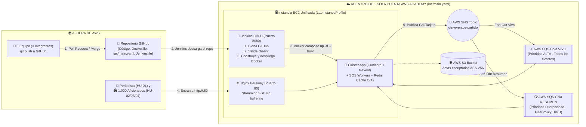

# 🚀 Guía Paso a Paso: Cómo Desplegar Todo en 1 Sola Cuenta de AWS Academy

Esta guía resume el flujo completo en **una única cuenta de AWS Academy** para que no dependan de encender múltiples laboratorios al mismo tiempo. Los otros 2 laboratorios del equipo quedan como **respaldo (backup)** o para practicar individualmente.

---

## 🏗️ 1. Arquitectura Unificada en 1 Sola Cuenta AWS



---

## ⚡ 2. Paso a Paso para Levantar Todo desde Cero (En 5 Minutos)

### Paso 1: Subir esta carpeta a su repositorio de GitHub
Suban el contenido de `solucion_proyecto/` a la raíz del repositorio de su equipo en GitHub (`gtn-proyecto-<nombre>`).

### Paso 2: Desplegar la Infraestructura en AWS con 1 solo comando (`Lab 05`)
1. Entren a **1 cuenta de AWS Academy** -> clic en **Start Lab** hasta que el círculo esté en verde 🟢 -> clic en **AWS** para abrir la consola.
2. Abran **AWS CloudShell** (el ícono `>_` en la barra superior derecha de la consola de AWS).
3. Clonen su repositorio de GitHub y ejecuten el comando de despliegue de CloudFormation:
   ```bash
   git clone https://github.com/<TU_USUARIO>/<TU_REPO>.git
   cd <TU_REPO>

   aws cloudformation deploy \
     --template-file iac/main.yaml \
     --stack-name gtn-unal-sports \
     --capabilities CAPABILITY_NAMED_IAM \
     --parameter-overrides \
       NombreEquipo=unal-sports \
       Ambiente=lab \
       ProyectoId=proyecto-06 \
       InstanceType=t3.small
   ```
4. Cuando termine (`Successfully created/updated stack - gtn-unal-sports`), consulten las URLs públicas que les entregó CloudFormation:
   ```bash
   aws cloudformation describe-stacks \
     --stack-name gtn-unal-sports \
     --query "Stacks[0].Outputs" \
     --output table
   ```
   Ahí verán:
   - `DemoURL`: `http://ec2-XX-XX-XX-XX.compute-1.amazonaws.com` *(Puerto 80 — Para los usuarios y el profesor)*
   - `JenkinsURL`: `http://ec2-XX-XX-XX-XX.compute-1.amazonaws.com:8080` *(Puerto 8080 — Para su pipeline CI/CD)*

---

### Paso 3: Configurar Jenkins en el Puerto 8080 para que despliegue solo (`Lab 04`)
CloudFormation ya instaló **Docker**, **Docker Compose**, **cfn-lint** y **Jenkins** dentro de la EC2. Solo deben activar el Pipeline:

1. En la consola de AWS vayan a **EC2 -> Instances**, seleccionen la instancia `gtn-unal-sports-ec2-server` y den clic en **Connect -> EC2 Instance Connect**.
2. En esa terminal de la EC2, vean la clave inicial de Jenkins:
   ```bash
   sudo cat /var/lib/jenkins/secrets/initialAdminPassword
   ```
3. Abran en su navegador el `JenkinsURL` (`http://<IP_PUBLICA_EC2>:8080`), peguen la contraseña, elijan **"Install suggested plugins"** y creen su usuario admin.
4. En Jenkins, den clic en **"New Item"** (Nueva Tarea):
   - Nombre: `gtn-proyecto-06-pipeline`
   - Tipo: **Pipeline** -> clic en **OK**.
   - Bajen a la sección **Pipeline**:
     - En **Definition** elijan: `Pipeline script from SCM`
     - En **SCM** elijan: `Git`
     - En **Repository URL**: peguen la URL de su repo de GitHub (`https://github.com/...`).
     - En **Branches to build**: `*/main`
     - En **Script Path**: `Jenkinsfile`
   - Den clic en **Save** y luego en **▶️ Build Now (Construir ahora)**.

**¿Qué hará Jenkins automáticamente en ese instante?**
1. Descargará todos los archivos de su GitHub a la EC2.
2. Correrá `cfn-lint iac/*.yaml` para validar CloudFormation.
3. Construirá la imagen Docker (`gtn-app:latest`).
4. Levantará con Docker Compose/Swarm los contenedores (`nginx` en puerto 80, `app` en puerto 8000, `sqs-worker` y `redis`) conectándolos automáticamente al **Topic SNS** y a las **2 Colas SQS** creadas por CloudFormation (`/etc/gtn-app.env`).
5. Ejecutará el **Simulador de Carga** para verificar que todo responde en milisegundos.

---

### Paso 4: ¡Probar la Plataforma en Vivo (Portal Aficionados vs. App Cabina del Periodista)!
1. **Para los Aficionados y el Profesor:** Abran en el computador proyectado `http://<IP_PUBLICA_EC2>` (Puerto 80).
   - Verán únicamente la vista limpia estilo **Apple Sports** de **Ingeniería FC vs. Ciencias Atlético**, sin ningún formulario de edición.
2. **Para el Periodista (Desde tu celular o en otra pestaña):** Abre la aplicación independiente de la **Cabina del Periodista** en `http://<IP_PUBLICA_EC2>:8001` (o en `http://<IP_PUBLICA_EC2>/periodista`).
   - Toca el botón **`⚽ GOL`** o **`🟨 AMARILLA`** y dale a **"🚀 Publicar en Vivo Ahora"**:
   - Verás cómo el portal público de los aficionados se actualiza instantáneamente sin recargar la página (`HU-02`).
   - En el portal de aficionados, alternen en el control estilo iOS entre **"⚡ En Vivo (Todo)"** y **"📋 Resumen Rápido (Entré tarde)"** para demostrar `HU-03` y el **Reto Extra**.
3. **Simulador de 1,000 Lectores (`HU-04`):** Desde la Cabina del Periodista haz clic en **"⚡ Disparar Ráfaga de Final (1,000 Lectores + 5 Jugadas Clave)"** (o ejecuta por consola `python3 app/simulator/load_simulator.py --url http://localhost:8000 --readers 1000`) para demostrar `HU-04` con métricas `p50`, `p95` y `p99`.
